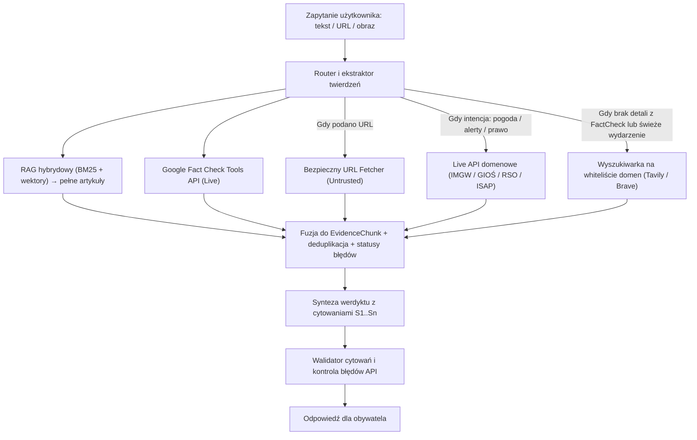

# Plan obsługi źródeł kontekstu — PRAWDOWID

Dokument opisuje plan pozyskiwania, indeksowania (RAG) oraz odpytywania na żywo (Live Query) omówionych źródeł danych w projekcie **Prawdowid**, z uwzględnieniem zasad konkursu MSZ, scenariuszy testowych (A–J) oraz ograniczeń technicznych (Cloudflare, brak `search` w MCP, limit czasu ≤ 30 s).

---

## 1. Zasady bazowe

- **Zakres korpusu:** obsługa źródeł opisanych w niniejszym planie jest wystarczającym spełnieniem wymogów formalnych zadania (różnorodność typów źródeł, liczba domen i rozmiar korpusu).
- **Audytowalność:** wszystkie źródła są zebrane w jednym rejestrze (`sources_registry.json`) z metadanymi (domena, typ, licencja, sposób pobrania, aktualizacja).
- **Aktualność:** każdy dokument przechowuje `published_at` (data publikacji) oraz `fetched_at` (data pobrania); system preferuje materiały aktualne i ostrzega o archiwalnych.
- **Legalność i bezpieczeństwo:**
  - **Zakaz obchodzenia zabezpieczeń** (np. Cloudflare `HTTP 403` na `demagog.org.pl`) i płatnych baz.
  - **Ochrona przed prompt injection:** treści z URL podanego przez użytkownika są traktowane i izolowane jako dane niezaufane (`untrusted`).
  - **Rozdzielenie awarii od werdyktu:** błąd API / brak klucza / limit zapytań nigdy nie jest zwracany jako werdykt merytoryczny (Scenariusz J).
  - **Katalog FIMI jako kontekst:** dopasowanie do bazy incydentów (np. EUvsDisinfo) nie może samodzielnie przesądzać o prawdziwości twierdzenia.

---

## 2. Architektura dwuwarstwowa: RAG vs Live Query

### Zasada podziału
1. **RAG (indeks lokalny — synchronizacja offline/cykliczna, Parent-Document Retrieval):**
   - Źródła bez własnego API wyszukiwania (EUvsDisinfo MCP, strony `gov.pl`, `odyseusz.gov.pl`, `moje.cert.pl`, `policja.pl` itd.).
   - RAG służy jako szybka wyszukiwarka wytypująca relewantne `article_id`, na podstawie których pobierane są **pełne artykuły wraz z metadanymi** dla modelu oceniającego.
   - Zapewnia czas wyszukiwania `< 200 ms`, wyszukiwanie semantyczne + wielojęzyczne oraz deterministyczny, audytowalny korpus źródeł.
2. **Live Query (w reakcji na request):**
   - Źródła z szybkim, gotowym API wyszukiwania (**Google Fact Check Tools API**, **ISAP**, **dane.gov.pl**).
   - Dane szybkozmienne / telemetryczne (**IMGW**, **GIOŚ**, **RSO XML**) — odpytywane warunkowo przez router z krótkim cache (TTL 10–15 min).
   - **Wyszukiwarka na whiteliście zaufanych domen** (Tavily / Brave Search) — legalne pozyskiwanie fragmentów z domen zablokowanych przed scrapingiem (Demagog) oraz najświeższych komunikatów „z dzisiaj/wczoraj” (Odyseusz, PAP).
   - **URL podany przez użytkownika** — pobierany wyłącznie na żądanie w izolowanym fetcherze.

### Przepływ zapytania



### Wspólny format dowodu (`EvidenceChunk`)
Niezależnie od źródła (RAG czy Live), każdy pobrany materiał jest normalizowany do jednej struktury przekazywanej do modelu:

```json
{
  "id": "S1",
  "source_type": "official | factcheck | fimi_catalog | user_url",
  "retrieval_method": "rag | live_api | web_search_whitelist | user_fetch",
  "publisher": "Demagog / MSZ Odyseusz / EUvsDisinfo",
  "domain": "demagog.org.pl",
  "url": "https://...",
  "title": "Tytuł dokumentu",
  "published_at": "2026-11-18T12:00:00Z",
  "fetched_at": "2026-11-21T16:30:00Z",
  "content": "Pełna treść artykułu (z RAG) lub pobrany fragment (z Live Query)...",
  "extra_metadata": {
    "textual_rating": "Częściowa prawda",
    "is_untrusted": false,
    "outbound_links": ["https://..."],
    "verified_live_at": "2026-11-21T16:30:02Z"
  }
}
```

### Dodatkowe mechanizmy weryfikacji linków i źródeł pierwotnych
- **Zachowywanie linków wychodzących (`outbound_links`) i 1-hop Link Following (Scenariusz A2):** Parser HTML dla źródeł urzędowych (`gov.pl`, `odyseusz.gov.pl`) nie może usuwać adresów URL zaszytych w znacznikach `<a href="...">` — zachowuje je w tekście (np. w formacie Markdown `[tekst](url)`) oraz zapisuje w `extra_metadata.outbound_links`. Gdy oficjalny komunikat odsyła do zewnętrznego portalu jako źródła szczegółów (np. włoskiej listy protestów `tg24.sky.it`), system może opcjonalnie pobrać treść linkowanego zasobu (`1-hop Link Following`), oznaczając go jako `linked_from_official` (z wyraźnym rozróżnieniem od źródła urzędowego).
- **Weryfikacja „żywej” dostępności źródła pierwotnego (`Live URL Availability Verifier` — Scenariusz A1):** Gdy sprawdzane twierdzenie dotyczy rzekomego usunięcia publikacji/depeszy (np. *„Czy PAP usunęła depeszę...”*), sam snippet z indeksu wyszukiwarki może pochodzić z cache'u. Jeśli z materiału fact-checkingowego lub wyszukiwarki wyłonimy URL źródła pierwotnego (np. na `pap.pl` lub `gov.pl`), system wykonuje szybki request `HEAD`/`GET` na ten adres, weryfikuje kod `HTTP 200`, pobiera nagłówek (`<title>` / `<h1>`) i zapisuje znacznik `verified_live_at` w `EvidenceChunk`, potwierdzając faktyczną dostępność materiału w chwili sprawdzenia.

---

## 3. Szczegółowy plan obsługi każdego źródła

### Grupa A: Weryfikacja faktów (Fact-Checking — IFCN / EFCSN)

| Źródło | Domena / Endpoint | Tryb | Sposób pobrania i obsługi | Fallback / Ograniczenia |
| :--- | :--- | :--- | :--- | :--- |
| **Google Fact Check Tools API** (Demagog, Konkret24, AFP Sprawdzam, Pravda) | `factchecktools.googleapis.com/v1alpha1/claims:search` | **Live Query (zawsze)** | Zapytanie REST z `languageCode=pl` i słowami kluczowymi z twierdzenia. Zwraca `text`, `claimant`, `textualRating`, `url`, `reviewDate`. | **Brak pełnej treści artykułu.** Jeśli potrzebne są szczegóły/liczby z analizy (Scenariusz C), dopytujemy przez **Wyszukiwarkę na whiteliście** (`site:demagog.org.pl`). Przy błędzie API zwracamy jawny komunikat techniczny (Scenariusz J). |
| **Demagog.org.pl** (bezpośrednio) | `demagog.org.pl` | **Zakaz scrapingu** | Obsługiwany **wyłącznie** przez Google Fact Check API + snippety z wyszukiwarki (Tavily/Brave `include_domains`). | `wp-json` i scraping blokowane przez Cloudflare (`HTTP 403`) — nie obchodzimy zabezpieczeń. |

---

### Grupa B: Katalog incydentów i operacji FIMI

| Źródło | Domena / Endpoint | Tryb | Sposób pobrania i obsługi | Fallback / Ograniczenia |
| :--- | :--- | :--- | :--- | :--- |
| **EUvsDisinfo MCP** | `euvsdisinfo-mcp-server.vercel.app/mcp` | **Tylko RAG (batch sync)** | Okresowe, paginowane pobieranie narzędzi `cases` i `articles` przez MCP i indeksowanie ich w lokalnym RAG (z wyraźnym rozdzieleniem fałszywego twierdzenia od sprostowania). | Serwer **nie udostępnia wyszukiwania (`search`)**, dlatego wymaga lokalnego indeksu. Rekordy oznaczane są jako kontekst FIMI (nie mogą samodzielnie przesądzać o werdykcie). |

---

### Grupa C: Podróże, dyplomacja i sytuacja międzynarodowa (MSZ)

| Źródło | Domena / Endpoint | Tryb | Sposób pobrania i obsługi | Fallback / Ograniczenia |
| :--- | :--- | :--- | :--- | :--- |
| **Odyseusz (MSZ)** | `odyseusz.gov.pl` | **Hybryda: RAG + Live fallback** | Cykliczny ingest ostrzeżeń i profili krajów do RAG (z zachowaniem `outbound_links` i opcjonalnym pobraniem linkowanego źródła `1-hop`), uzupełniany przez wyszukiwarkę `site:odyseusz.gov.pl` przy pytaniach o bieżące wydarzenia zagraniczne (np. Scenariusz A2 — strajk we Włoszech). | Brak publicznego API i RSS. Gdy komunikat odsyła do zewnętrznego portalu (np. listy protestów), przekazujemy oba linki z rozróżnieniem na źródło urzędowe i linkowane. |
| **MSZ — Informacje dla podróżujących** | `gov.pl/web/dyplomacja/informacje-dla-podrozujacych` | **RAG (cykliczny sync)** | Pobieranie komunikatów i ostrzeżeń wspólnym parserem dla stron `gov.pl` (z ekstrakcją `outbound_links`). | Uzupełniane wyszukiwarką `site:gov.pl/web/dyplomacja` przy świeżych zapytaniach. |

> **Uwaga dot. scrapingu `odyseusz.gov.pl` i `gov.pl` (SPA / dynamiczny JS):** Część podstron ostrzeżeń na `gov.pl` (np. `gov.pl/web/gov/ostrzezenia#/_/mazowieckie/wszystkie` z routingiem po hashu `#/_/`) oraz niektóre widoki `odyseusz.gov.pl` ładują dane dynamicznie przez wewnętrzne wywołania XHR/JSON lub wymagają wyrenderowania JS (zwykły `GET` na adres główny może zwrócić pusty kontener HTML). Przed implementacją parsera należy zweryfikować w DevTools docelowe pod-endpointy JSON lub parsować klasyczne drzewo podstron krajów, traktując wyszukiwarkę `site:odyseusz.gov.pl` / `site:gov.pl` jako stały bezpiecznik.

---

### Grupa D: Zarządzanie kryzysowe, ostrzeżenia i służby

| Źródło | Domena / Endpoint | Tryb | Sposób pobrania i obsługi | Fallback / Ograniczenia |
| :--- | :--- | :--- | :--- | :--- |
| **Regionalny System Ostrzegania (RSO)** | `komunikaty.tvp.pl/komunikatyxml/wszystkie/wszystkie/0?_format=xml` | **Live Query (cache 15 min) + opcjonalny sync RAG** | Pobieranie aktywnych komunikatów z otwartego endpointu XML (region, kategoria, treść, ważność). | Odpytywane przez router przy pytaniach o bieżące alerty i zagrożenia. |
| **Portale `gov.pl`** (RCB raport dobowy, MSWiA, KPRM, KGPSP, MON, GIS, MI, Wody Polskie) | `gov.pl/web/{rcb,mswia,premier,kgpsp,obrona-narodowa,gis,infrastruktura,wody-polskie}` | **RAG (cykliczny sync)** | Wspólny parser HTML dla szablonu `gov.pl`, pobierający bieżące aktualności i ostrzeżenia wraz z datą publikacji i linkiem. | Dla komunikatów z ostatnich godzin — fallback przez wyszukiwarkę `site:gov.pl`. |
| **CERT Polska (NASK)** | `moje.cert.pl/komunikaty/` | **RAG (cykliczny sync)** | Cykliczne pobieranie komunikatów bezpieczeństwa (phishing, oszustwa, alerty cyber) do RAG. | Uzupełnienie o kontekst cyberbezpieczeństwa i fałszywych kampanii. |
| **Policja / Policja Mazowiecka** | `policja.pl/pol/aktualnosci`, `*.policja.gov.pl` (np. `mazowiecka.policja.gov.pl`, `bochnia.policja.gov.pl`) | **RAG (cykliczny sync)** | Cykliczne pobieranie aktualności i ostrzeżeń (np. oszustwa, komunikaty kryzysowe) do RAG. | Dodatkowe oficjalne źródło służb. |

---

### Grupa E: Pogoda, środowisko, promieniowanie i transport

| Źródło | Domena / Endpoint | Tryb | Sposób pobrania i obsługi | Fallback / Ograniczenia |
| :--- | :--- | :--- | :--- | :--- |
| **IMGW (Meteo / Hydro)** | `danepubliczne.imgw.pl/api/data/{synop,meteo,hydro}` | **Live Query (warunkowe, cache 15 min)** | Publiczne REST API JSON bez klucza, odpytywane tylko przy pytaniach o pogodę, stany rzek lub ostrzeżenia hydro/meteo. | Dane pomiarowe szybko się dezaktualizują — nie indeksujemy ich w RAG. |
| **GIOŚ (Jakość powietrza)** | `api.gios.gov.pl/pjp-api/` | **Live Query (warunkowe, cache 15 min)** | Publiczne REST API JSON, uruchamiane tylko dla pytań o jakość powietrza / smog. | Jak wyżej — lepiej sprawdza się jako zapytanie na żywo niż w RAG. |
| **Transport i żegluga** (ULC, UTK, KGSOK, SAR, Urzędy Morskie) | `ulc.gov.pl`, `utk.gov.pl`, `kgsok.pl`, `sar.gov.pl`, `umgdy.gov.pl`, `ums.gov.pl` | **RAG (wybrane komunikaty / poradniki)** | Cykliczny ingest wybranych aktualności i poradników (np. prawa pasażera ULC/UTK). | Źródła uzupełniające — niższy priorytet niż grupy A–D. |
| **GDDKiA / PAA / Portal Pasażera** | `drogi.gddkia.gov.pl`, `monitoring.paa.gov.pl`, `portalpasazera.pl` | **Opcjonalne (fallback wyszukiwarką)** | Brak prostego otwartego API (GDDKiA wymaga rejestracji KPD dla pełnych strumieni). | W razie potrzeby obsługiwane wyłącznie przez wyszukiwarkę na whiteliście domen. |

---

### Grupa F: Prawo i otwarte dane publiczne

| Źródło | Domena / Endpoint | Tryb | Sposób pobrania i obsługi | Fallback / Ograniczenia |
| :--- | :--- | :--- | :--- | :--- |
| **ISAP / Sejm ELI** | `api.sejm.gov.pl/eli/` | **Live Query (warunkowe)** | Otwarte REST API JSON odpytywane przez router przy pytaniach o akty prawne i przepisy. W odpowiedzi cytujemy czytelny adres ISAP (`isap.sejm.gov.pl/isap.nsf/DocDetails.xsp?id=` + pole `address` z API, np. `WDU20220000655`) lub `…/text.pdf`, a nie surowy endpoint JSON. | Zbyt duża baza, aby indeksować całość w lokalnym RAG. `isap.sejm.gov.pl` blokuje boty (Incapsula), więc dane bierzemy wyłącznie z API. |
| **EUR-Lex** | `eur-lex.europa.eu` (SPARQL / CELLAR) | **Live Query (warunkowe)** | Akty i orzeczenia UE po numerze CELEX/ELI (np. rozporządzenie 261/2004 o prawach pasażerów). Punkt odniesienia z sekcji 7 zadania. | Cytujemy adres ELI/CELEX w wersji PL. |
| **Komisja Europejska / Your Europe** | `europa.eu/youreurope`, `economy-finance.ec.europa.eu`, `european-union.europa.eu` | **RAG (cykliczny sync)** | Prawa obywatela UE (np. odszkodowania lotnicze) i prognozy gospodarcze KE. | Prognozy KE są okresowe, więc zapisujemy datę publikacji. |
| **Urząd Lotnictwa Cywilnego** | `ulc.gov.pl`, `pasazerlotniczy.ulc.gov.pl` | **RAG (jednorazowy ingest)** | Materiały ULC o prawach pasażerów (PDF). | Strona HTML blokuje boty (Incapsula); indeksujemy publiczne PDF-y. |
| **dane.gov.pl** | `api.dane.gov.pl` | **Live Query (warunkowe)** | Wyszukiwanie zbiorów danych publicznych po słowach kluczowych. | Używane jako źródło pierwotne przy pytaniach statystycznych i rejestrowych. |

---

### Grupa G: Wyszukiwarka na whiteliście domen (Live Fallback)

| Źródło / Narzędzie | Zakres domen | Tryb | Sposób pobrania i obsługi | Fallback / Ograniczenia |
| :--- | :--- | :--- | :--- | :--- |
| **Tavily API** lub **Brave Search API** | Ściśle ograniczony do domen z `sources_registry.json` (`demagog.org.pl`, `odyseusz.msz.gov.pl`, `gov.pl` wraz z podportalami, np. `gov.pl/web/finanse`, `gov.pl/web/wielkabrytania`, `gov.pl/web/gddkia`, `gov.pl/web/paa`, `pap.pl`, `cert.pl`, `policja.pl` i `*.policja.gov.pl` (komendy wojewódzkie i powiatowe, np. `bochnia.policja.gov.pl`), `konkret24.tvn24.pl`, `sprawdzam.afp.com`, `europa.eu`, `ulc.gov.pl`, `zus.pl`, `gov.uk` (tylko jako link 1-hop z komunikatu placówki RP)) | **Live Query (warunkowe)** | Zwraca fragmenty treści bezpośrednio z indeksu wyszukiwarki (`include_domains` / `extra_snippets`), bez konieczności scrapowania strony źródłowej. | Legalnie omija problem braku treści w Google Fact Check API przy blokadzie Cloudflare (Demagog) i łapie bieżące wydarzenia (Odyseusz, PAP). Przy braku wystarczających detali w snippetach model komunikuje ograniczenie zamiast zgadywać. |

---

### Grupa H: URL podany przez użytkownika (Untrusted Live Fetch)

| Źródło | Tryb | Sposób pobrania i obsługi | Fallback / Ograniczenia |
| :--- | :--- | :--- | :--- |
| **Dowolny URL wklejony przez użytkownika** (Scenariusze B, E, I) | **Live Query (tylko gdy podano link)** | Jednorazowe, bezpieczne pobranie strony i ekstrakcja czystego tekstu na potrzeby bieżącej weryfikacji. | Treść jest zawsze izolowana jako niezaufana (odporność na prompt injection z Scenariusza E), a próby manipulacji są logowane. **Nigdy nie trafia do zaufanego indeksu RAG.** |

---

## 4. Kluczowe zasady pracy z RAG w tym projekcie

- **Parent-Document Retrieval (RAG → pełne artykuły):** RAG pełni rolę wyszukiwarki typującej relewantne `article_id`. Na ich podstawie z głównej bazy pobierane są pełne artykuły wraz z metadanymi (wydawca, typ źródła, data publikacji, URL) i dopiero one trafiają do osobnego modelu oceniającego.
- **Wyszukiwanie hybrydowe (BM25/FTS + wektory):** same embeddingi słabo radzą sobie z nazwami własnymi, liczbami i datami (*Pcim*, *650 mln zł*, *20 listopada 2026*), dlatego wyszukiwarka musi łączyć dopasowanie pełnotekstowe z semantycznym.
- **Wielojęzyczne embeddingi:** opisy w EUvsDisinfo są głównie po angielsku, a zapytania użytkowników po polsku — wielojęzyczny model embeddingów pozwala wyszukiwać je bezpośrednio bez dodatkowego tłumaczenia.
- **Łagodny próg trafności (priorytet na recall):** ponieważ pełne artykuły weryfikuje osobny model oceniający, w RAG odcinamy jedynie ewidentny szum (oszczędność tokenów i czasu odpowiedzi), pozostawiając ostateczną ocenę relewantności i decyzję o wstrzymaniu się od werdyktu modelowi.

---

## 5. Kolejność podłączania źródeł (MVP)

1. **`sources_registry.json`** — wspólny rejestr zaufanych domen, typów źródeł i licencji (używany przez RAG i whitelistę wyszukiwarki).
2. **Live #1: Google Fact Check Tools API** z jawną obsługą błędów dostępu (Scenariusze A1, B, C, E, F, G, I, **J**).
3. **Live #2: Wyszukiwarka na whiteliście (Tavily / Brave)** — uzupełnianie fragmentów z Demagoga (C) i bieżących komunikatów z Odyseusza/PAP (A1, A2).
4. **RAG Ingest:** EUvsDisinfo MCP + wspólny parser `gov.pl` (MSZ, RCB, GIS, MSWiA, MON, MI, KGPSP, KPRM) + `odyseusz.gov.pl`, `moje.cert.pl`, `policja.pl`.
5. **Live #3: Bezpieczny URL Fetcher** dla linków od użytkownika (Scenariusze B, E, I).
6. **Live #4 (warunkowe przez router):** RSO XML, IMGW API, GIOŚ API oraz ISAP ELI API.
