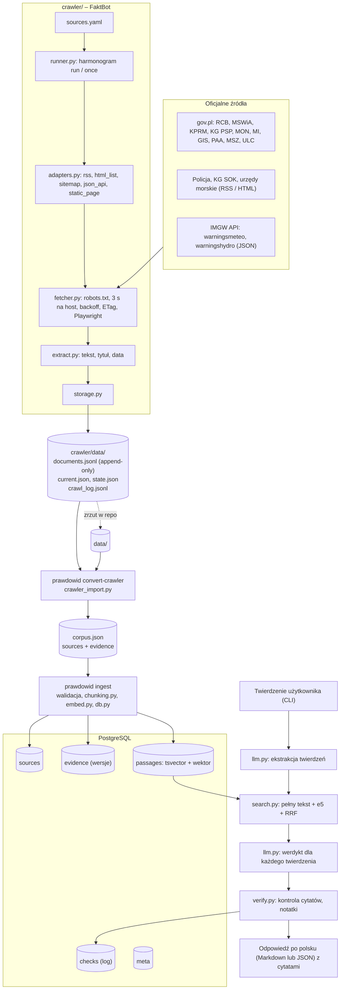

# Architektura systemu Prawdowid

> Stan na 2026-11-21, po scaleniu crawlera (`crawler/`) i RAG (`backend/`) w jedno repozytorium.
> Opis powstał na podstawie kodu, nie planów. Tam, gdzie plany różnią się od kodu, piszemy to wprost
> (zob. [§11](#11-ograniczenia-i-znane-luki)).

## Spis treści

1. [Cel i zakres](#1-cel-i-zakres)
2. [Przepływ danych od źródła do odpowiedzi](#2-przepływ-danych-od-źródła-do-odpowiedzi)
3. [Crawler FaktBot (`crawler/`)](#3-crawler-faktbot-crawler)
4. [Backend RAG (`backend/`)](#4-backend-rag-backend)
5. [Kontrakt crawler ↔ RAG](#5-kontrakt-crawler--rag)
6. [Schemat bazy danych](#6-schemat-bazy-danych)
7. [Indeksowanie: fragmenty, pełny tekst, wektory](#7-indeksowanie-fragmenty-pełny-tekst-wektory)
8. [Wyszukiwanie hybrydowe](#8-wyszukiwanie-hybrydowe)
9. [Weryfikacja i odpowiedź](#9-weryfikacja-i-odpowiedź)
10. [Kluczowe decyzje projektowe](#10-kluczowe-decyzje-projektowe)
11. [Ograniczenia i znane luki](#11-ograniczenia-i-znane-luki)
12. [Dokumentacja szczegółowa](#12-dokumentacja-szczegółowa)

---

## 1. Cel i zakres

Prawdowid sprawdza twierdzenia (pogłoski, doniesienia) na podstawie **oficjalnych źródeł państwowych**.
Powstał na konkurs MSZ ([treść zadania](task/)). Użytkownik podaje tekst, a system:

1. wyodrębnia z niego twierdzenia, które da się sprawdzić,
2. dla każdego twierdzenia wyszukuje fragmenty komunikatów, ostrzeżeń i raportów instytucji publicznych,
3. prosi model językowy o ocenę wyłącznie na podstawie tych fragmentów,
4. sprawdza w kodzie, czy model cytuje tylko to, co dostał, i czy cytaty uzasadniają werdykt,
5. zwraca po polsku werdykt z cytatami i ostrzeżeniami (np. o wygasłym ostrzeżeniu albo nieaktualnym źródle).

System składa się z dwóch luźno powiązanych części:

| Część | Rola | Technologia | Uruchamianie |
|---|---|---|---|
| **Crawler FaktBot** ([`../crawler/`](../crawler/)) | Zbiera dokumenty ze źródeł i zapisuje je w plikach z pełną historią wersji. Nie zna bazy ani RAG. | Python, httpx, Playwright (Chromium), trafilatura, BeautifulSoup, lxml | `python crawler.py run \| once \| status` (z katalogu `crawler/`, osobne środowisko z [`requirements.txt`](../crawler/requirements.txt)) |
| **Backend RAG** ([`../backend/`](../backend/), pakiet `prawdowid`) | Importuje wynik crawlera, indeksuje go w PostgreSQL, wyszukuje i weryfikuje twierdzenia. | Python ≥ 3.10, PostgreSQL ≥ 14 (psycopg 3), NumPy, opcjonalnie sentence-transformers, OpenAI / Anthropic SDK, Typer | `uv run prawdowid …` (z katalogu głównego, [`pyproject.toml`](../pyproject.toml)) |

Łącznikiem jest **plik**: crawler dopisuje do `crawler/data/documents.jsonl`, a polecenie
`prawdowid convert-crawler` zamienia te dane na `corpus.json`, który ładuje `prawdowid ingest`.
W repozytorium leży zamrożony zrzut danych crawlera w [`../data/`](../data/) (98 dokumentów z 2026-11-21 i wygenerowany
`corpus.json`). Jest to domyślne wejście `convert-crawler`.

Interfejsem użytkownika jest dziś **wyłącznie CLI** (`prawdowid verify`). Nie ma serwera WWW, endpointu HTTP
ani drugiego kanału (zob. [§11](#11-ograniczenia-i-znane-luki)).

## 2. Przepływ danych od źródła do odpowiedzi

Kroki poza crawlerem uruchamia się ręcznie. Nie ma harmonogramu, który po przebiegu crawlera sam odświeża bazę.

## 3. Crawler FaktBot (`crawler/`)

Crawler jest „grzeczny”: przestrzega robots.txt (RFC 9309), wysyła najwyżej jedno zapytanie na 3 s do jednego hosta,
wycofuje się po 429/503/403 i nie obchodzi CAPTCHA ani wyzwań antybotowych. Konfiguracja źródeł jest w
[`../crawler/sources.yaml`](../crawler/sources.yaml): 25 wpisów, z czego 20 włączonych
(8 × `html_list`, 5 × `rss`, 4 × `static_page`, 2 × `json_api`, 1 × `sitemap`). Wyłączone są `cert-polska-komunikaty`,
`utk`, `wody-polskie-nawigacyjne`, `ulc` i `rso-ogolne`.

### 3.1. Moduły

| Plik | Odpowiedzialność |
|---|---|
| [`crawler.py`](../crawler/crawler.py) | CLI (`run`, `once [--source]`, `status`, `--max-items`, `--data-dir`). Blokada `data/.lock` (`fcntl`, drugi proces kończy się kodem 3). Pierwszy SIGINT/SIGTERM kończy pracę po bieżącym źródle, drugi przerywa od razu. |
| [`faktbot/config.py`](../crawler/faktbot/config.py) | Wczytanie i walidacja `sources.yaml`, wartości domyślne (`interval_minutes` 60, `max_items_per_run` 30, `recheck_hours` 24, `mask_pii` false). User-Agent `FaktBot/1.0 (+mail)`. Bez poprawnego maila (`CRAWLER_CONTACT` lub `settings.contact`) crawler nie startuje. |
| [`faktbot/runner.py`](../crawler/faktbot/runner.py) | Przebieg jednego źródła, wyliczenie statusu (`ok`, `warn`, `not_modified`, `error`, `blocked`, `throttled`), wpis do `crawl_log.jsonl`. Pętla `run`: zawsze najbardziej zaległe źródło. Raport `status` z alarmami (blokada, 3 błędy z rzędu, cisza dłuższa niż `silence_alert_hours`). |
| [`faktbot/adapters.py`](../crawler/faktbot/adapters.py) | Pięć adapterów. Wybór kandydatów: najpierw nowe adresy (najświeższe), potem ponowne sprawdzenie po `recheck_hours`. Kolejka zaległych (`pending`, maks. 300). Adres oznaczany jako `failed` po 3 błędach z rzędu. Izolacja błędów per host. `json_api`: rekord = dokument o adresie `endpoint#id`, treść to spłaszczone linie `klucz: wartość`. |
| [`faktbot/fetcher.py`](../crawler/faktbot/fetcher.py) | Jedyna droga do sieci. Kolejno: backoff hosta, robots.txt (także przy każdym przekierowaniu, maks. 5), odstęp ≥ 3 s (lub więcej, gdy `Crawl-delay`), zapytania warunkowe (`If-None-Match`, `If-Modified-Since`). Po 429/503 backoff 15 min lub `Retry-After`, po 403 60 min. Wykrywa strony-wyzwania (Cloudflare, Incapsula, DataDome…). Renderowanie w Playwright: dokument pobrany przez httpx jest podawany przeglądarce przez `route.fulfill`, a obrazy, czcionki, style i trackery są blokowane. |
| [`faktbot/robots.py`](../crawler/faktbot/robots.py) | Parser robots.txt: grupy, `*`, `$`, najdłuższe dopasowanie (przy remisie wygrywa `Allow`), `Crawl-delay`. |
| [`faktbot/extract.py`](../crawler/faktbot/extract.py) | Ekstrakcja treści: `content_selector`, potem trafilatura, potem `<article>`/`<main>` (kolejny sposób, gdy poprzedni dał < 80 znaków). Tytuł, daty po polsku (strefa Europe/Warsaw), linki z list, RSS/Atom, sitemapy, lista załączników. |
| [`faktbot/storage.py`](../crawler/faktbot/storage.py) | `documents.jsonl` tylko dopisywany (z `fsync`). `current.json` i `state.json` zapisywane atomowo (plik tymczasowy + `os.replace`). Gdy `current.json` jest starszy od JSONL, indeks jest odbudowywany. |
| [`faktbot/pii.py`](../crawler/faktbot/pii.py) | `PiiMasker`: spaCy NER (`persName`) zamienia osoby na `[OSOBA]`, regex zamienia PESEL na `[PESEL]`. **Dziś nieużywany**, bo żadne źródło nie ma `mask_pii: true`. |
| [`tests/run_local_test.py`](../crawler/tests/run_local_test.py), [`tests/local_server.py`](../crawler/tests/local_server.py) | Test end-to-end offline na lokalnym serwerze HTTP. |
| [`tools/inspect_xhr.py`](../crawler/tools/inspect_xhr.py) | Narzędzie pomocnicze do podglądu zapytań XHR strony. |

### 3.2. Wynik: `crawler/data/`

Katalog danych jest ustalany względem pliku konfiguracji (`settings.data_dir: data`, czyli `crawler/data/`).

| Plik | Zawartość |
|---|---|
| `documents.jsonl` | Jedna linia = jedna **wersja** dokumentu: `id` (`<16 hex sha256(url)>-v<n>`), `url`, `source`, `institution`, `doc_type`, `region`, `title`, `content`, `content_hash` (SHA-256 samej treści), `version`, `published_at`, `fetched_at`, `fetch_method`, opcjonalnie `attribution`. Starych linii się nie zmienia. |
| `current.json` | Indeks `url → {version, content_hash, id}`. |
| `state.json` | Stan źródeł (`known`, `pending`, `list_cache`, `history`, `active_ids` dla `json_api`), walidatory HTTP, aktywne backoffy. |
| `crawl_log.jsonl` | Jeden wpis na przebieg źródła: `status`, liczniki (`found`, `new`, `updated`, `unchanged`, `skipped`, `errors`), `message`. |
| `crawler.log` | Log tekstowy. |

Nowa wersja powstaje tylko wtedy, gdy zmieni się **treść** (`content_hash`). Zmiana samego tytułu albo daty
nie daje nowej linii. Szczegóły: [`crawler/docs/DATA_FORMAT.md`](../crawler/docs/DATA_FORMAT.md).

## 4. Backend RAG (`backend/`)

### 4.1. Moduły

| Plik | Odpowiedzialność |
|---|---|
| [`cli.py`](../backend/cli.py) | CLI Typer `prawdowid`: `convert-crawler`, `ingest`, `reembed`, `stats`, `search`, `verify`. |
| [`config.py`](../backend/config.py) | Wczytanie `.env` (zmienne z powłoki mają pierwszeństwo), `DATABASE_URL`. |
| [`crawler_import.py`](../backend/crawler_import.py) | Konwersja `documents.jsonl` + `crawl_log.jsonl` → `corpus.json` (zob. [§5](#5-kontrakt-crawler--rag)). |
| [`ingest.py`](../backend/ingest.py) | Ładowanie korpusu: upsert źródeł, walidacja rekordów, pominięcie niezmienionych, chunking, embeddingi w partiach po 256 rekordów, zapis. `reembed` przelicza wektory innym modelem. |
| [`db.py`](../backend/db.py) | Połączenie (autocommit), zakładanie i kontrola schematu (`SCHEMA_VERSION = 1`, blokada doradcza), wersjonowany upsert rekordu w jednej transakcji, hasz treści, log sprawdzeń, `scratch_db()` dla testów. |
| [`database/`](../backend/database/) | Cały SQL: [`schema.sql`](../backend/database/schema.sql) i nazwane zapytania w [`queries/*.sql`](../backend/database/queries/). Wartości trafiają do SQL wyłącznie jako parametry psycopg. |
| [`chunking.py`](../backend/chunking.py) | Podział artykułów na fragmenty (≤ 300 słów) i stałe polskie szablony dla rekordów strukturalnych. |
| [`embed.py`](../backend/embed.py) | `E5Embedder` (`intfloat/multilingual-e5-small`, prefiksy `query: ` / `passage: `) i `HashEmbedder` (n-gramy znakowe, do testów bez pobierania modelu). Funkcja `_fold` (małe litery, bez diakrytyków, `ł→l`). |
| [`search.py`](../backend/search.py) | Wyszukiwanie pełnotekstowe (Postgres `tsvector`), gęste (NumPy), fuzja RRF, filtry, różnorodność wyników. |
| [`llm.py`](../backend/llm.py) | Schematy Pydantic, prompty, klienci OpenAI i Anthropic ze strukturalnym wyjściem, liczenie tokenów i kosztu. |
| [`verify.py`](../backend/verify.py) | Potok weryfikacji, kontrola cytatów, notatki o wygaśnięciu i nieaktualności, wykrywanie prompt injection, maskowanie logu, render Markdown. |
| [`timeutil.py`](../backend/timeutil.py) | Parsowanie ISO 8601, zapis w UTC, wyświetlanie w Europe/Warsaw. |
| [`evaluation.py`](../backend/evaluation.py) | Metryki wyszukiwania (recall@k, MRR) dla plików przypadków. |

Pomocnicze: [`../scripts/eval_retrieval.py`](../scripts/eval_retrieval.py) (BM25 vs dense vs hybryda),
[`../scripts/eval_verify.py`](../scripts/eval_verify.py) (werdykty na żywym LLM),
[`../fixtures/`](../fixtures/) (sztuczny korpus w domenie `.test` i przypadki testowe), [`../tests/`](../tests/) (pytest,
każdy test w jednorazowym schemacie Postgresa `scratch_<id>`), [`../docker-compose.yml`](../docker-compose.yml) (PostgreSQL 16).

### 4.2. Polecenia CLI

| Polecenie | Domyślne | Co robi |
|---|---|---|
| `convert-crawler` | `--documents data/documents.jsonl`, `--crawl-log data/crawl_log.jsonl`, `--out data/corpus.json` | Konwersja wyniku crawlera, wypisuje liczbę rekordów wg `kind` i źródła bez dokumentów. |
| `ingest CORPUS` | `--embedder hash` | Ładuje korpus, wypisuje statystyki akcji (`inserted`, `new_version`, `unchanged`, `known_version`, `invalid`). |
| `reembed` | `--embedder e5` | Przelicza wektory wszystkich fragmentów bieżących wersji. |
| `stats` | – | Liczniki: rekordy unikalne / bieżące / wersje, domeny, typy źródeł, fragmenty przeszukiwalne. |
| `search QUERY` | `--embedder hash`, `--mode hybrid`, `--k 8`, `--area` | Pokazuje listę po fuzji z rangami z poszczególnych list. |
| `verify TEXT` | `--embedder hash`, `--now` (teraz, Warszawa), `--json`, `--provider`, `--model` | Pełna weryfikacja. Na stderr: status, model, czas, liczba wywołań, tokeny, koszt. |

Każde polecenie z bazą przyjmuje `--database-url`. Ten sam `--embedder` musi być użyty w `ingest`, `search`
i `verify`. Przy niezgodności wyszukiwanie gęste kończy się błędem z prośbą o `prawdowid reembed`.
Uwaga: domyślny embedder w `ingest`, `search` i `verify` to `hash`, a w `reembed` to `e5`.

## 5. Kontrakt crawler ↔ RAG

Kontrakt realizuje [`crawler_import.py`](../backend/crawler_import.py). Wejście to **wszystkie linie**
`documents.jsonl` (wszystkie wersje, w kolejności pliku) oraz ostatni wpis `crawl_log.jsonl` dla każdego źródła.
Wyjście to `{"sources": [...], "evidence": [...], "_crawl_without_documents": [...]}`.

### 5.1. Rekord dokumentu → rekord `evidence`

| Pole crawlera | Pole korpusu | Uwagi |
|---|---|---|
| `source` | `source_id` | |
| `url` | `upstream_id`, `citation_url` | Dla `warning_meteo` `upstream_id` = pole `id` z API, a `citation_url` zostaje `endpoint#id`. |
| `title` | `title` | Wymagane przez walidację `ingest`. Gdy crawler zapisał `title: null`, w miejsce tytułu trafia URL. |
| `content` | `sections[0].text` (artykuły) albo typowane `fields` (IMGW) | Artykuł: jedna sekcja bez nagłówka, akapit na każdą niepustą linię, pierwsza linia usuwana, jeśli powtarza tytuł. |
| `published_at` | `published_at` (UTC, `Z`) | Czas bez strefy jest traktowany jako czas warszawski. |
| `fetched_at` | `fetched_at` (UTC, `Z`) | Czas bez strefy jest traktowany jako UTC. |
| `region` | `areas: [region]` | Dla IMGW zastępowane obszarami z treści. |
| `doc_type` | `kind` | Tabela w §5.2. |
| `attribution` | `fields.attribution` | Obecne dziś tylko w IMGW. |
| `institution` | `sources[].publisher` | Z pierwszego dokumentu danego źródła. |
| `id`, `version`, `content_hash`, `fetch_method` | – | Nieprzenoszone. RAG liczy własny hasz i własne wersje. |

### 5.2. `doc_type` → `kind`

| `doc_type` (crawler) | `kind` (RAG) | Fragmenty |
|---|---|---|
| `komunikat`, `ostrzezenie`, `informacja` | `article` | Dosłowne fragmenty tekstu (`is_verbatim = true`) |
| `raport` | `report` | jw. |
| `ostrzezenie_meteo` | `warning_meteo` | Jeden fragment z szablonu (`is_verbatim = false`) |
| `ostrzezenie_hydro` | `warning_hydro` | jw. |
| każdy inny (np. `komunikat_nawigacyjny`, `ostrzezenie_rso` w wyłączonych źródłach) | `article` | Dosłowne |

`source_type` źródła ma wartość `structured`, gdy pierwszy dokument źródła jest typu `ostrzezenie_meteo` lub
`ostrzezenie_hydro`, a w innych przypadkach `official`. Szablony `air_reading` i `road_restriction` w
[`chunking.py`](../backend/chunking.py) istnieją, ale żaden importer ich dziś nie produkuje.

### 5.3. Ostrzeżenia IMGW: z linii `klucz: wartość` do pól typowanych

Crawler zapisuje rekord API jako spłaszczone linie (`obszary[0].opis: …`). Konwerter parsuje je z powrotem
(`_kv`; zostaje pierwsze wystąpienie klucza).

| Pole korpusu | `warning_meteo` (klucz API) | `warning_hydro` (klucz API) |
|---|---|---|
| `upstream_id` | `id` (lub URL, gdy brak) | URL `endpoint#<numer-rok-biuro>` |
| `published_at` | `opublikowano` | `opublikowano` |
| `valid_from` / `valid_to` | `obowiazuje_od` / `obowiazuje_do` | `data_od` / `data_do` |
| `status` | – | `"obowiązuje do odwołania"`, gdy `data_do` zaczyna się od `9999` (wtedy `valid_to = null`) |
| `areas` | Kody `teryt` (powiaty) zgrupowane po dwóch pierwszych cyfrach: `"województwo pomorskie (10 powiatów)"` | Wartości `obszary[i].opis` |
| `fields.phenomenon` | `nazwa_zdarzenia` | `zdarzenie` |
| `fields.level` | `stopien` (int) | `stopień` (int) |
| `fields.probability` | `prawdopodobienstwo` | `prawdopodobienstwo` |
| `fields.office` | `biuro` | `biuro` |
| `fields.description` | `tresc` + `Komentarz: …` (gdy nie „Brak”) | `przebieg` + `komentarz` (pomijane „Brak”) |
| inne | `issuer: "IMGW-PIB"`, `teryt`, `attribution` | `issuer`, `number` (`numer`), `attribution` |

Wymagane pola dla rekordu strukturalnego to `phenomenon` i `level`. Bez nich rekord jest odrzucany jako `invalid`.

### 5.4. Rekord źródła (`sources`)

Rekord źródła powstaje z **pierwszego dokumentu** danego `source`:
`publishing_domain` = host URL bez `www.`, `citation_url` = `https://<host>/`, `publisher` = `institution`,
`terms_url` i `refresh_policy` = `null`. Z ostatniego wpisu `crawl_log.jsonl` dla źródła:
`ok` i `not_modified` oznaczają udany przebieg (`last_error = null`). Przy innym statusie (`warn`, `blocked`, `throttled`,
`error`) ustawiane jest `last_error = "<status>: <message>"`. `last_success_at` to `finished_at` ostatniego **udanego**
przebiegu w całym logu, więc późniejsza awaria nie kasuje wcześniejszego sukcesu. Niepełna ostatnia linia pliku JSONL
(crawler właśnie dopisuje) jest pomijana.
Źródła, które przeszły crawl, ale nie mają żadnego dokumentu, nie trafiają do `sources`. Konwerter wypisuje je
w `_crawl_without_documents`. W zrzucie z 2026-11-21 są to `cert-polska` (robots.txt blokuje kanał
`moje.cert.pl`) i `sar` (wyzwanie Incapsula).

### 5.5. Tożsamość, wersje i deduplikacja

Wersjonowanie działa na dwóch poziomach:

| Poziom | Tożsamość | Kiedy nowa wersja | Gdzie |
|---|---|---|---|
| Crawler | `url` | Zmienił się SHA-256 pola `content` | `storage.Store.save_document` |
| RAG | `(source_id, upstream_id)` | Zmienił się SHA-256 kanonicznego JSON z pól `kind`, `title`, `citation_url`, `published_at`, `observed_at`, `valid_from`, `valid_to`, `areas`, `status`, `syndicated_from`, `fields`, `sections` (bez `fetched_at`) | `db.content_hash`, `db.upsert_evidence` |

`ingest` przetwarza rekordy w kolejności pliku, więc kolejne wersje z crawlera stają się kolejnymi wersjami w bazie:

* **hasz już jest i to wersja bieżąca** → `unchanged` (bez chunkingu i embeddingów),
* **hasz już jest, ale w wersji archiwalnej** → `known_version`; stara treść nie wraca jako bieżąca,
* **nowa treść** → wstawiana wersja `n+1`, poprzednia dostaje `is_current = false` i `superseded_by`,
  a jej fragmenty `fts = NULL` (znikają z wyszukiwania, ale zostają do śledzenia dawnych cytatów).

Ponowny `convert-crawler` + `ingest` tych samych danych jest więc idempotentny. Każdy zapis zwiększa
`meta.corpus_version`, co unieważnia macierz wektorów trzymaną w pamięci przez wyszukiwarkę.

### 5.6. Walidacja `citation_url` i `publishing_domain`

`ingest.check_record` odrzuca rekord (licznik `invalid`, ostrzeżenie w logu, reszta pliku ładuje się dalej), gdy:

* brakuje któregoś z pól `source_id`, `upstream_id`, `kind`, `title`, `citation_url`,
* `source_id` nie ma w tabeli `sources`,
* `citation_url` nie jest `https` albo jego host nie jest równy `publishing_domain` źródła ani nie jest jej subdomeną.

Przy renderowaniu odpowiedzi URL jest dodatkowo sprawdzany (`verify._safe_url`: tylko http(s) z hostem, znaki
łamiące link Markdown są kodowane). Model nie może dodać własnych linków (zob. [§9](#9-weryfikacja-i-odpowiedź)).

### 5.7. Strefy czasowe

| Miejsce | Konwencja |
|---|---|
| Crawler `fetched_at`, stan, log | UTC (`+00:00`) |
| Crawler `published_at` | ISO 8601 ze strefą. Daty polskie i daty bez strefy z RSS/API są czytane jako Europe/Warsaw. |
| Konwersja | Wszystko do UTC z sufiksem `Z`. Czas bez strefy w `published_at` i polach IMGW jest traktowany jako warszawski, w `fetched_at` jako UTC. Rok ≥ 9999 daje `null`. |
| Baza | Czasy jako tekst ISO 8601 w UTC, porównywane w Pythonie (nie w SQL). |
| LLM | Czas żądania w Europe/Warsaw (`--now`, domyślnie teraz). Model zamienia „dziś”, „wczoraj” na ISO z przesunięciem. Atrybuty dowodów dostaje w UTC. |
| Użytkownik | `timeutil.fmt_local`: Europe/Warsaw, `DD.MM.RRRR GG:MM` lub `DD.MM.RRRR`. Brak daty to „brak danych”. |

## 6. Schemat bazy danych

Źródło: [`../backend/database/schema.sql`](../backend/database/schema.sql). DDL jest idempotentny i wykonywany przy
każdym połączeniu. Zmiana schematu wymaga podbicia `SCHEMA_VERSION` w [`db.py`](../backend/db.py).

| Tabela | Kluczowe kolumny | Rola |
|---|---|---|
| `meta` | `key`, `value` | `schema_version` (1), `corpus_version` (licznik zmian korpusu) |
| `sources` | `source_id` (PK), `publisher`, `publishing_domain`, `source_type`, `citation_url`, `terms_url`, `refresh_policy`, `last_success_at`, `last_error` | Katalog źródeł i stan ostatniego pobrania. Pola stanu są nadpisywane tylko wtedy, gdy rekord je zawiera. |
| `evidence` | `evidence_id` (PK), `source_id` (FK), `upstream_id`, `version`, `is_current`, `superseded_by`, `content_hash`, `kind`, `title`, `citation_url`, `published_at`, `fetched_at`, `observed_at`, `valid_from`, `valid_to`, `areas_json`, `status`, `syndicated_from`, `fields_json` | Wersjonowane rekordy dowodowe. `UNIQUE (source_id, upstream_id, version)`, indeks `(source_id, upstream_id, is_current)`. |
| `passages` | `passage_id` (PK), `evidence_id` (FK), `ord`, `heading`, `page`, `excerpt`, `search_text`, `is_verbatim`, `embedding` (BYTEA, float32), `embedding_model`, `fts` (TSVECTOR) | Fragmenty do wyszukiwania. Indeks GIN na `fts`. `fts = NULL` oznacza fragment wersji archiwalnej. |
| `checks` | `check_id` (PK, UUID), `created_at`, `input_masked`, `status`, `result_json`, `corpus_version`, `model`, `embedding_model`, `duration_ms` | Log każdej weryfikacji z zamaskowanymi danymi wejściowymi. |

Wektory nie korzystają z rozszerzenia pgvector. Są przechowywane jako bajty i porównywane w NumPy.

## 7. Indeksowanie: fragmenty, pełny tekst, wektory

1. **Chunking** ([`chunking.py`](../backend/chunking.py)):
   * artykuły: każda sekcja dzielona po akapitach (pusta linia) na fragmenty do `MAX_WORDS = 300` słów. Akapit
     dłuższy niż limit jest dzielony po zdaniach. Ogon krótszy niż `MIN_TAIL_WORDS = 60` słów jest doklejany
     do poprzedniego fragmentu. `excerpt` = dosłowny tekst fragmentu,
   * rekordy strukturalne: jeden fragment ze stałego szablonu, np. „Ostrzeżenie meteorologiczne IMGW-PIB: Oblodzenie.
     Stopień: 1. Obszar: … Obowiązuje: 22.11.2026 01:00 – 22.11.2026 08:00. Wydano: …”. `excerpt = NULL`, więc
     w odpowiedzi fragment jest pokazywany jako „Dane ze źródła”, a nie jako cytat.
2. **Pełny tekst**: `fts = setweight(tytuł, 'A') || setweight(nagłówek, 'B') || setweight(treść, 'C')`, konfiguracja
   `simple` na tekście złożonym przez aplikację (`_fold`: małe litery, bez diakrytyków, `ł→l`).
3. **Wektory**: tekst `tytuł\nnagłówek\ntreść`. E5: prefiks `passage: `, `max_seq_length = 512`, wektory
   znormalizowane, partie po 32. Hash: 512 wymiarów, n-gramy znakowe 3–5 (tylko do testów, bez semantyki).

Zrzut z `data/` (98 rekordów: 61 `article`, 35 `warning_hydro`, 1 `warning_meteo`, 1 `report`) daje 132 fragmenty.

## 8. Wyszukiwanie hybrydowe

Źródło: [`../backend/search.py`](../backend/search.py), klasa `Retriever`.

| Krok | Szczegóły (wartości z kodu) |
|---|---|
| 1. Zapytania | Dla twierdzenia: `[claim.text, *claim.search_queries]` bez duplikatów (model zwraca 1–3 zapytania, w tym jedno mogące wydobyć sprostowanie). Razem do 4 zapytań. |
| 2. Tokeny | `_fold`, tokeny `\w+` dłuższe niż 1 znak, bez ok. 50 polskich słów funkcyjnych (`STOPWORDS`), bez powtórzeń. |
| 3. Pełny tekst („bm25”) | `to_tsquery('simple', …)`: OR tokenów. Tokeny ≥ 6 znaków (nie liczby) stają się prefiksami `t[:max(5, len-3)]:*` („Mazowszu” → `mazow:*`), co zastępuje stemmer. Ranking `ts_rank_cd('{0, 0.2, 0.6, 1.0}', fts, q, 0)`: treść 0,2, nagłówek 0,6, tytuł 1,0, bez normalizacji długości. To ranking gęstości pokrycia Postgresa, a nie BM25 w ścisłym sensie. |
| 4. Gęste | Macierz wektorów wszystkich fragmentów **bieżących** wersji w pamięci procesu, przeładowywana po zmianie `corpus_version`. Iloczyn skalarny (wektory znormalizowane, więc to podobieństwo cosinusowe), `argpartition`. Zapytanie z prefiksem `query: `. |
| 5. Lista na metodę | `k_each = 20` wyników z każdej metody dla każdego zapytania. Z filtrami pobierane jest `k × 5` kandydatów i filtrowane w Pythonie. |
| 6. Fuzja RRF | `score = Σ 1 / (60 + rank)` po wszystkich listach (`RRF_K = 60`, rangi od 1). Duplikat w jednej liście liczy się raz. Remis rozstrzyga najlepsza ranga. |
| 7. Różnorodność | Najwyżej `per_group = 2` fragmenty z jednej grupy (`syndicated_from` albo `source_id:upstream_id`). Lista końcowa `shortlist = 8`. |
| Filtry (opcjonalne) | `source_types`, `kinds`, `area` (podciąg po złożeniu; rekordy bez obszaru przechodzą), `since`/`until` (na podstawie `valid_from`/`observed_at`/`published_at` i `valid_to`). Używa ich `prawdowid search --area` i ewaluacja. **Weryfikator ich nie przekazuje.** |

## 9. Weryfikacja i odpowiedź

Źródła: [`../backend/verify.py`](../backend/verify.py) (`Verifier`) i [`../backend/llm.py`](../backend/llm.py).

### 9.1. Kroki

1. **Limit wejścia.** Tekst dłuższy niż `MAX_INPUT_CHARS = 10 000` znaków daje status `too_long`, bez wywołania LLM.
2. **Ekstrakcja twierdzeń** (1 wywołanie LLM, schemat `ClaimExtraction`). Tekst użytkownika jest w
   `<user_input>`, z `<` i `>` zamienionymi na `‹ ›`. Dla każdego twierdzenia model zwraca: `text`, `search_queries`,
   `entities`, `area`, `time_from`, `time_to`, `quantifiers`, `checkable`. Statusy:
   `needs_clarification` (pytanie doprecyzowujące, gdy miejsce lub czas są niezbędne i niejasne), `out_of_scope`
   (brak twierdzenia o faktach), `ok`. Model oznacza też `injection_detected`.
3. **Limit twierdzeń.** Sprawdzane jest pierwsze `MAX_CLAIMS = 5` twierdzeń, z komunikatem „Sprawdzam pierwsze 5 z N”.
4. **Wyszukiwanie** ([§8](#8-wyszukiwanie-hybrydowe)) sekwencyjnie dla każdego twierdzenia z `checkable = true`.
   * Twierdzenie niesprawdzalne (opinia, prognoza) dostaje `unverifiable` bez wywołania LLM.
   * Pusta lista wyników daje `insufficient` bez wywołania LLM, z dopiskiem, że brak wyniku nie oznacza fałszu.
5. **Werdykt** (1 wywołanie LLM na twierdzenie, równolegle, `LLM_WORKERS = 4`, schemat `ClaimVerdict`). Lista
   dowodów trafia do modelu jako bloki `<evidence id="P123" publisher=… source_type=… kind=… published=…
   valid_from=… valid_to=… areas=… verbatim=…>` z tytułem, sekcją, tekstem i polami JSON. Fragment, który
   wygląda na instrukcję dla AI (regex `_INSTRUCTION_RX`), dostaje atrybut `warning`. Model nie ma narzędzi ani
   przeglądarki. Zwraca `verdict`, etykiety fragmentów (`supports` / `contradicts` / `context`),
   `explanation_pl` (2–4 zdania), `evidence_strength`, `conflict`, `injection_noticed`.
6. **Kontrola w kodzie** (`_enforce`):
   * identyfikatory spoza listy wyników są usuwane i zapisywane w `invented_ids`, duplikaty są odrzucane,
   * werdykt musi mieć pokrycie w rolach zachowanych cytatów: `true` wymaga `supports`, `false` wymaga `contradicts`,
     `misleading` wymaga `supports` lub `contradicts`. Gdy go nie ma, werdykt jest obniżany do `insufficient`
     (`downgraded_from`), a wyjaśnienie dostaje prefiks „Model nie wskazał źródeł, które potwierdzają tę ocenę…”,
   * `conflict = true`, gdy model tak oznaczył albo wśród cytatów są jednocześnie `supports` i `contradicts`.
7. **Cytaty.** Najpierw `supports` / `contradicts`, potem `context`. Tekst cytatu: `excerpt` (dosłowny) albo tekst
   z szablonu (strukturalny), przycięty do 400 znaków. Data: `published_at`, potem `observed_at`, potem `valid_from`.
8. **Notatki** (`_notes`):
   * ostrzeżenie lub utrudnienie (`warning_meteo`, `warning_hydro`, `road_restriction`) z `valid_to` wcześniejszym
     niż `claim.time_from` (albo „teraz”): „Ostrzeżenie ze źródła … wygasło …”,
   * źródło z `last_error`: „Ostatnia aktualizacja źródła … nie powiodła się; dane pochodzą z …”,
   * źródło `structured` z `last_success_at` starszym niż `STALE_AFTER = 48 h`: „Dane ze źródła … mogą być nieaktualne”,
   * wykryta próba prompt injection w dowodach: notatka o zignorowanej instrukcji.
9. **Izolacja błędów.** Błąd jednego twierdzenia (awaria, odmowa, złe wyjście) daje dla niego werdykt `error`.
   Gdy wszystkie twierdzenia się nie powiodą, status całości to `error` z komunikatem o niedostępności usługi.
   Odmowa modelu (`LLMRefusal`) na etapie ekstrakcji daje „Nie mogę przetworzyć tego zapytania.”
10. **Log.** Każde sprawdzenie (gdy `record=True`, domyślnie tak) trafia do `checks`. Wejście i pola tekstowe wyniku
    są maskowane regexami: e-mail, IBAN/NRB, PESEL (11 cyfr), numer dowodu, telefon.
11. **Render** (`render_markdown`). Tekst od modelu jest escapowany (`\`, `` ` ``, `[`, `]`, `<`, `>`), a URL-e w nim
    są zastępowane przez „(adres usunięty)”. Linki pochodzą wyłącznie z `citation_url` w bazie. Format:
    **Twierdzenie**, **Ocena**, wyjaśnienie, ewentualna informacja o konflikcie, notatki „⚠”, lista **Źródła**
    z rolą („potwierdza”, „przeczy”, „kontekst”) i cytatem (`>`) albo „Dane ze źródła: …”. `--json` zwraca pełny
    `CheckResult`.

### 9.2. Werdykty i statusy

| Kod | Etykieta dla użytkownika |
|---|---|
| `true` | potwierdzone |
| `false` | fałszywe |
| `misleading` | wprowadzające w błąd |
| `insufficient` | brak wystarczających dowodów |
| `unverifiable` | nie podlega weryfikacji |
| `error` | nie udało się sprawdzić |

Statusy całego sprawdzenia: `ok`, `needs_clarification`, `out_of_scope`, `too_long`, `error`.

### 9.3. Modele i limity

| Parametr | Wartość |
|---|---|
| Dostawca | `--provider` / `PRAWDOWID_PROVIDER`: `openai` (domyślnie) lub `anthropic` |
| OpenAI | `chat.completions.parse` ze ścisłym `response_format`. Model `OPENAI_MODEL`, domyślnie `gpt-5.5`. `OPENAI_REASONING_EFFORT` jest wysyłany tylko wtedy, gdy ustawiony. |
| Anthropic | `beta.messages.parse` z `output_format`. Model `PRAWDOWID_MODEL`, domyślnie `claude-opus-5-5`. `effort`: `low` dla ekstrakcji, `medium` dla werdyktu. Przy odmowie klasyfikatora API ponawia żądanie na modelu zapasowym (`server-side-fallback`). |
| Limit czasu | `PRAWDOWID_LLM_TIMEOUT`, domyślnie 60 s, 1 ponowienie |
| Maks. tokenów wyjścia | 16 000 |
| Wywołania na sprawdzenie | 1 (ekstrakcja) + do 5 (werdykty) |
| Koszt | Raportowany dla modeli z cennika `PRICES` albo z `PRAWDOWID_PRICE_IN` / `PRAWDOWID_PRICE_OUT` |

## 10. Kluczowe decyzje projektowe

* **Crawler i RAG są rozdzielone plikiem.** Crawler nic nie wie o bazie. `documents.jsonl` jest tylko dopisywany
  i stanowi audytowalną historię („co instytucja napisała pierwotnie”). Import jest wsadowy i idempotentny, więc
  bazę można w każdej chwili odbudować z plików.
* **Legalność ponad kompletność.** Źródło zablokowane przez robots.txt lub wyzwanie antybotowe dostaje status
  `blocked` i nie ma żadnych prób obejścia. Każdy przekierowany adres jest sprawdzany w robots.txt osobno.
  Crawler nie startuje bez maila kontaktowego w User-Agencie.
* **Stabilna tożsamość i pełna historia.** Rekord identyfikuje para `(source_id, upstream_id)`. Wersje archiwalne
  zostają w bazie (bez indeksu pełnotekstowego), więc dawne cytaty da się prześledzić.
* **Dane strukturalne nie są cytowane.** Ostrzeżenia IMGW są renderowane z pól typowanych stałym szablonem.
  Model dostaje też surowe pola, a użytkownik widzi je jako „Dane ze źródła”, nie jako cytat.
* **Model nie jest źródłem prawdy o cytatach.** Model dostaje tylko listę wyników jako escapowane dane, bez narzędzi.
  Kod odrzuca zmyślone identyfikatory, obniża werdykty bez pokrycia w cytatach, usuwa linki z tekstu modelu
  i bierze URL-e wyłącznie z bazy.
* **Uczciwe wstrzymanie się.** Brak wyników daje „brak wystarczających dowodów”, nigdy „fałszywe”. Prompt każe
  preferować `insufficient`, gdy dowody nie rozstrzygają sprawy.
* **Wymienny model i dostawca.** Interfejs `LLM` (Protocol) ze wspólnymi promptami i schematami. Backend implementuje
  tylko `_parse`.
* **SQL poza Pythonem.** Wszystkie zapytania są w plikach `.sql` jako nazwane instrukcje, z parametrami psycopg.
  Jedyny składany identyfikator (nazwa schematu testowego) przechodzi przez `psycopg.sql.Identifier`.
* **Proste wyszukiwanie wektorowe.** Przy obecnym rozmiarze korpusu wystarcza pełne skanowanie macierzy NumPy
  w pamięci, bez pgvector i bez rerankera.
* **Czasy w UTC, prezentacja po warszawsku**, porównania w Pythonie (czasy jako tekst w bazie).
* **Testy bez sieci i bez modelu.** `HashEmbedder` i jednorazowe schematy Postgresa. Korpus testowy używa domeny `.test`.

## 11. Ograniczenia i znane luki

### 11.1. Funkcjonalność

* **Brak interfejsu WWW, API HTTP i drugiego kanału.** Jedynym wejściem jest `prawdowid verify` w CLI. Plan
  ([`plan.md`](plan.md) §3) zakłada `POST /verify` wspólny dla WWW i adaptera. Regulamin konkursu wymaga interfejsu WWW
  i drugiego kanału. Nie ma też weryfikacji **adresu URL** podanego przez użytkownika.
* **Weryfikator nie używa wyodrębnionego obszaru ani okresu do filtrowania.** `claim.area`, `time_from` i `time_to`
  trafiają do modelu w treści twierdzenia, ale `Verifier.retrieve` wywołuje wyszukiwanie bez `Filters`. `time_from`
  służy tylko do notatki o wygaśnięciu.
* **Wyszukiwanie pełnotekstowe** to `ts_rank_cd` z obcinaniem prefiksów zamiast polskiego stemmera. Nie ma rerankera.
* **Załączniki (PDF, DOC) nie są pobierane.** Gdy komunikat jest w pliku, w treści zostaje tylko lista
  „Komunikat opublikowany w załączniku:” z linkami.
* **Odświeżanie jest ręczne.** Aktualność bazy zależy od ostatniego `convert-crawler` + `ingest`. Notatka
  o nieaktualności (48 h) dotyczy tylko źródeł `structured`.
* Szablony `air_reading` (GIOŚ) i `road_restriction` (GDDKiA) są gotowe, ale nie mają importera.

### 11.2. Źródła i korpus

* **Maskowanie danych osobowych w crawlerze jest wyłączone** (`mask_pii: false` w źródłach policji, decyzja
  właściciela projektu z 2026-11-21). [`crawler/docs/DATA_FORMAT.md`](../crawler/docs/DATA_FORMAT.md) i
  [`crawler/docs/SPEC.md`](../crawler/docs/SPEC.md) §8 wymagają maskowania przed publikacją danych, a regulamin konkursu
  zabrania danych osobowych w repozytorium. Mimo to zrzut w [`../data/`](../data/) jest śledzony przez git i zawiera
  niezamaskowane komunikaty policji (co najmniej jedno imię i nazwisko funkcjonariusza). RAG nie maskuje dowodów.
  Maskowanie w `verify.py` dotyczy tylko logu `checks`.
* **Źródła bez dokumentów:** `cert-polska` (robots.txt `moje.cert.pl` blokuje kanał RSS) i `sar` (Incapsula).
  Nie trafiają do tabeli `sources`, więc ich błąd nie jest widoczny w notatkach weryfikatora.
* **Wymogi konkursu dotyczące korpusu** (≥ 100 rekordów, ≥ 10 domen, ≥ 2 typy źródeł): zrzut w `data/` ma 98 rekordów,
  2 typy źródeł i 7 różnych `publishing_domain`. Wszystkie serwisy gov.pl liczą się jako jedna domena `gov.pl`.
  Według [`../README.md`](../README.md) przebieg na żywo dał 221 rekordów. Liczby domen z tego przebiegu
  ten dokument nie weryfikuje.
* `publishing_domain` dla wszystkich źródeł z `www.gov.pl` to `gov.pl`, więc walidacja `citation_url` przepuszcza
  dla nich dowolną subdomenę `*.gov.pl`.
* `citation_url` ostrzeżeń IMGW wskazuje endpoint JSON API (`…/warningsmeteo#id`), a nie stronę dla człowieka.
  Atrybucja IMGW (wymóg licencji, [`DATA_FORMAT.md`](../crawler/docs/DATA_FORMAT.md) §7.4) jest w `fields.attribution`
  i trafia do modelu, ale odpowiedź w Markdown jej nie pokazuje.
* `sources.yaml` ma tymczasowy adres kontaktowy (`settings.contact`). Przed uruchomieniem trzeba ustawić `CRAWLER_CONTACT`.

### 11.3. Błędy i niespójności w kodzie

* **Wycofane ostrzeżenia IMGW zostają bieżące.** Konwerter nie czyta `state.json → active_ids`, które według
  [`DATA_FORMAT.md`](../crawler/docs/DATA_FORMAT.md) §7.4 wskazuje aktualne ostrzeżenia. Ostrzeżenie hydrologiczne
  „do odwołania” (`valid_to = null`) po zniknięciu z API pozostaje w bazie jako obowiązujące i nie dostaje notatki
  o wygaśnięciu.
* **Szablon `warning_hydro` zawsze pokazuje „Rzeka: brak danych”**, bo konwerter nie wypełnia `fields.river`.
* **Powrót do starszej treści jest ignorowany.** Gdy źródło zmieni treść A→B→A, crawler zapisze wersję 3 (= A),
  ale `ingest` rozpozna hasz wersji 1 jako `known_version` i bieżąca w bazie zostanie B. Komentarz w `db.find_by_hash`
  zakłada, że prawdziwy powrót ma nowy czas aktualizacji, ale artykuły z crawlera go nie mają, bo `fetched_at` nie
  wchodzi do hasza.
* Brak testów dla `crawler_import.py`.

### 11.4. Rozbieżności z dokumentami planistycznymi

* [`plan.md`](plan.md) §2 opisuje SQLite z FTS5. Kod używa PostgreSQL z `tsvector`.
* [`PLAN_OBSLUGI_ZRODEL.md`](PLAN_OBSLUGI_ZRODEL.md) przewiduje IMGW, GIOŚ, RSO i wyszukiwarkę jako zapytania na żywo
  (Live Query), a URL od użytkownika jako pobranie na żywo. W kodzie nie ma warstwy Live Query: ostrzeżenia IMGW są
  indeksowane w RAG, a pozostałych źródeł na żywo nie ma.

## 12. Dokumentacja szczegółowa

| Dokument | Zawartość |
|---|---|
| [`../README.md`](../README.md) | Szybki start całego systemu |
| [`URUCHOMIENIE.md`](URUCHOMIENIE.md) | Instalacja od zera, cykl pracy, testy, rozwiązywanie problemów |
| [`../crawler/README.md`](../crawler/README.md) | Crawler: instalacja, uruchamianie, zasady |
| [`../crawler/docs/SPEC.md`](../crawler/docs/SPEC.md) | Pełna specyfikacja zachowania crawlera (robots, backoff, adaptery, statusy, PII) |
| [`../crawler/docs/CONFIG.md`](../crawler/docs/CONFIG.md) | Wszystkie klucze `sources.yaml`, tabela źródeł, dodawanie źródła |
| [`../crawler/docs/DATA_FORMAT.md`](../crawler/docs/DATA_FORMAT.md) | Format `crawler/data/`, JSON Schema, wskazówki dla konsumentów |
| [`../crawler/RAPORT.md`](../crawler/RAPORT.md) | Raport z przebiegu na prawdziwych stronach |
| [`../backend/README.md`](../backend/README.md) | RAG: instalacja, moduły, konwencje SQL, format korpusu (EN) |
| [`plan.md`](plan.md) | Plan implementacji (EN) |
| [`PLAN_OBSLUGI_ZRODEL.md`](PLAN_OBSLUGI_ZRODEL.md) | Plan obsługi źródeł: RAG vs zapytania na żywo |
| [`DODATKOWE_ZRODLA_I_API.md`](DODATKOWE_ZRODLA_I_API.md) | Dodatkowe źródła i API |
| [`task/`](task/) | Treść i regulamin zadania konkursowego |
